<div align="center">

<h3><code>nilesh@github ~ $ ./contributions.sh</code></h3>


</div>

<br>

<div align="center">

<br><br>


<br><br>
<a href="https://nileshraj.pro/"></a>
<a href="https://agentnine.pro"></a>
<a href="https://www.linkedin.com/in/nilesh-raj-nr1735/"></a>
<a href="mailto:nileshraj1735@gmail.com"></a>
<a href="https://github.com/Nilesh1735"></a>
<br><br>


</div>

### `> whoami`
Founder and AI engineer. I build and ship AI systems end to end, from architecture to live deployment: agentic systems, RAG pipelines and fine-tuned transformers. I run [AgentNine](https://agentnine.pro), a live directory of open-source AI agents, and have shipped CrewAI multi-agent platforms, LangGraph RAG pipelines and BERT classifiers. I treat JWT RBAC, rate limiting and observability as seriously as prompt design and model accuracy.

```bash
$ cat .profile

ROLE        =  Founder & AI Engineer @ AgentNine
EXP         =  Founder (Jun 2026 - now)  |  Ex AI/ML Trainee  |  BCA (AI)
DOMAIN      =  Agentic Workflows  |  RAG  |  Fine-tuned NLP  |  Web Products
STACK       =  Python  |  LangGraph  |  CrewAI  |  FastAPI  |  Next.js  |  Docker
AI_INFRA    =  FAISS  |  Mistral / DeepSeek / Gemini / OpenAI  |  MongoDB  |  Redis  |  Supabase
LOCATION    =  India
OPEN_TO     =  AI/ML Engineer Roles  +  Forward Deployed Positions
```

### `> ls /tech-stack`

**[ Languages ]**
<div align="center">
  
  
</div>

**[ AI / ML & GenAI ]**
<div align="center">
  
  
  
  
  
  
</div>

**[ Product & Web ]**
<div align="center">
  
  
</div>

**[ Backend, DB & Infra ]**
<div align="center">
  
</div>

**[ Cloud & DevOps ]**
<div align="center">
  
  
</div>

### `> cat specialty-badges.sh`
<div align="center">
  
  
  
</div>

### `> cat expertise.json`
<div align="center">
 
| Domain | Details |
| :--- | :--- |
| **Agentic AI** | LangGraph, CrewAI, Multi-Agent Systems, ReAct Framework |
| **RAG & Enrichment** | LangChain, FAISS, Snov.io API, Dynamic Query Routing, LangSmith |
| **LLM Integration** | Mistral AI, DeepSeek, OpenAI, Google Gemini, NVIDIA NIM, Ollama |
| **Product & Web** | Next.js, React, TypeScript, Tailwind CSS, Supabase, Vitest |
| **Deployment** | Docker, FastAPI, Render, Vercel, WebSocket Telemetry |
| **Machine Learning** | Scikit-learn, PyTorch, BERT, Hugging Face, Fine-tuning |
| **AppSec** | JWT RBAC, SSRF Protection, Prompt Injection Guardrails, Secret Scanning |

</div>

### `> ls /projects --sort=impact`

<details open>
<summary><b>&#9654; AgentNine | Open-Source AI Agent Directory</b></summary>

A live directory of open-source AI agents with 110+ listings across coding, automation, research and content. Each listing shows its source repository, install steps for Windows, macOS and Linux, the access it requests, and what is still undocumented.

| Aspect | Detail |
| :-- | :-- |
| **Stack** | Next.js App Router &middot; React 19 &middot; TypeScript &middot; Tailwind CSS &middot; Supabase Postgres &middot; Vitest |
| **Browse** | Category filters, OS and API-key facets, Fuse.js full-text search, side-by-side comparison of three agents with no account |
| **Verification** | Five-step setup check: exact commit reviewed, operating systems checked, install command, a first task actually run, and the date |
| **Deployment** | Vercel |
| **Live** | [agentnine.pro](https://agentnine.pro) |

</details>

<details>
<summary><b>&#9654; OMNICREW AI | Autonomous Web Extraction & Enrichment Platform</b></summary>

A full-stack agentic platform where a multi-agent crew (Researcher, Analyst) scrapes web data, structures it, and enriches it through third-party APIs. Built with a resilient backend and real-time observability.

| Aspect | Detail |
| :-- | :-- |
| **Stack** | Python &middot; CrewAI &middot; LangChain &middot; FastAPI &middot; React/TS &middot; Docker &middot; Redis |
| **AI & Enrichment** | 3-tier LLM fallback router (DeepSeek, Mistral AI, Gemini) with 99.9% task completion on real-time extraction, Snov.io API for B2B email enrichment |
| **Performance** | Redis MD5 caching of LLM responses cuts latency from 2.5s to under 50ms on cache hits; MD5 deduplication with INSERT IGNORE cut redundant writes by ~35% |
| **Backend** | MySQL (Aiven) for leads, Upstash Redis for zero-cost caching, JWT user data isolation |
| **Security** | SSRF blocking: target URLs are resolved and private, local and cloud-metadata IP ranges are rejected before any fetch |
| **Frontend** | Next.js 16 with GSAP/Lenis smooth scrolling, live WebSocket telemetry feeds |
| **Deployment** | Frontend on Vercel, Backend on Render, containerized via Docker |
| **Repo** | [View on GitHub](https://github.com/Nilesh1735/OMNICREW-AI) |

</details>

<details>
<summary><b>&#9654; LumanGuide | Agentic RAG System & Team Navigator</b></summary>

An agentic RAG system built on a LangGraph state machine, with a split-screen UI, live agent telemetry, and AppSec measures for secure client deployment.

| Aspect | Detail |
| :-- | :-- |
| **Stack** | Python &middot; LangGraph &middot; FAISS &middot; FastAPI &middot; MongoDB Atlas &middot; LangSmith &middot; Streamlit |
| **AI Architecture** | Document grading and query routing cut retrieval latency by 30% against a naive RAG baseline; Tavily web search as a fallback |
| **Retrieval Loop** | An LLM-as-judge node scores retrieval quality and sends weak results to a rewrite node that loops back |
| **Vector Store** | FAISS with semantic chunking for sub-second retrieval |
| **Backend** | Auth moved from SQLite to MongoDB Atlas (Motor), which ended the data-wipe incidents; persistent chat history |
| **Security** | Prompt-injection guardrails, JWT RBAC, regex secret scanning that redacts credentials before anything reaches the vector store |
| **Repo** | [View on GitHub](https://github.com/Nilesh1735/LumanGuide-Onboarding-Illuminated) |

</details>

### `> cat experience.log`

**[Jun 2026 - Present]** **Founder and AI Engineer | AgentNine**

Built and launched agentnine.pro, a directory of open-source AI agents, and lead product and technical decisions with a small team.

- Built the product on Next.js App Router, React 19, TypeScript and Tailwind CSS, with Supabase Postgres for auth and data, a Vitest suite, and deployment on Vercel.
- Designed the browse experience: category filters, OS and API-key facets, Fuse.js search, and three-way comparison without an account.
- Defined the five-step setup check behind each listing and grew the catalogue past 110 agents.

`Next.js` `React` `TypeScript` `Supabase` `Tailwind` `Vitest` `Vercel`

**[Feb - May 2026]** **AI/ML Trainee | Technosavvys Education Technology**

Fine-tuned a BERT classifier on 500+ student course reviews with Hugging Face and turned it into something non-technical staff could use.

- Reached 88% accuracy, a 15% lift over the TF-IDF baseline, using learning-rate scheduling and dropout tuning.
- Shipped a Streamlit dashboard backed by SQLite that cut report generation for 10+ mentors across 5+ courses from hours to minutes.
- Rewrote the NLP preprocessing pipeline (text normalisation, feature extraction), which removed manual data entry from the weekly reporting workflow.

`Python` `BERT` `Hugging Face` `Streamlit` `SQLite` `NLP`

### `> echo $ACHIEVEMENTS`
<div align="center">

| Win | Detail |
| :--- | :--- |
| &#9612; **Founded** | Launched AgentNine (agentnine.pro) with 110+ open-source AI agents listed |
| &#9612; **Project Launch** | Deployed OMNICREW AI & LumanGuide to production (Render/Vercel) |
| &#9612; **Certification** | Completed "Building LLM Applications with Prompt Engineering" from the NVIDIA Deep Learning Institute |
| &#9612; **Academic** | Graduated with a BCA in Artificial Intelligence (IBM Specialization) |

</div>

### `> git log --oneline /education`
<div align="center">
  <a href="#"></a>
</div>

### `> git stats --global`
<div align="center">


<br><br>

</div>

### `> ./snake-animation.sh`
<div align="center">
  
</div>

### `> cat current-focus.yaml`
```yaml
building:
  - AgentNine   # open-source AI agent directory, growing the catalogue and verification

shipped:
  - OMNICREW AI # multi-agent web extraction and enrichment
  - LumanGuide  # agentic RAG on LangGraph and MongoDB Atlas

learning:
  - Agentic AI architectures & multi-agent orchestration
  - LLM Fine-tuning & RAG Optimization

exploring:
  - Real-time voice AI & low-latency LLM pipelines
  - NVIDIA NIM Microservices

open_to:
  - AI/ML Engineer Roles
  - Forward Deployed Engineer (FDE) Positions
  - Collaborations on Agentic AI Pipelines
```

### `> ping me`
<div align="center">
  <a href="mailto:nileshraj1735@gmail.com"></a>
  <a href="https://www.linkedin.com/in/nilesh-raj-nr1735/"></a>
  <a href="https://github.com/Nilesh1735"></a>
</div>

<br>

<div align="center">
  <i>building AgentNine | shipping agentic systems and RAG pipelines</i>
</div>

<br>

<div align="center">

</div>
